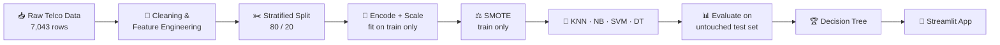
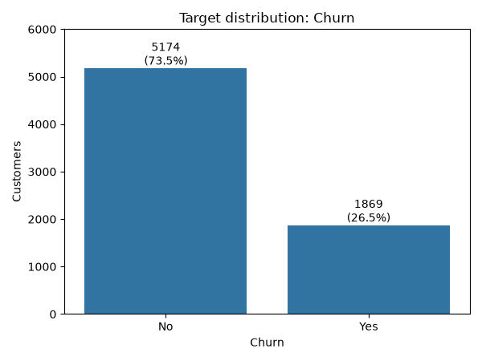
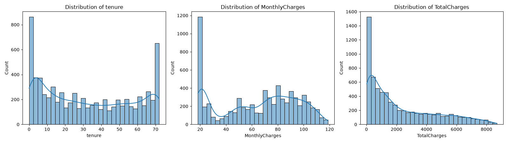
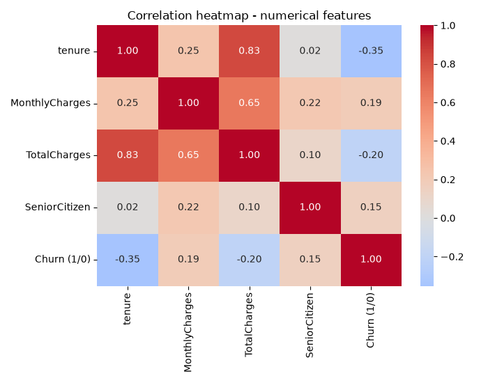
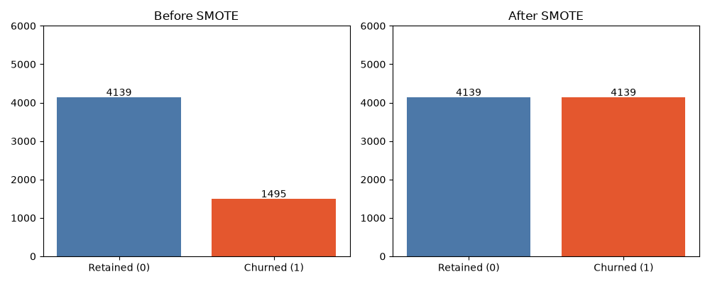
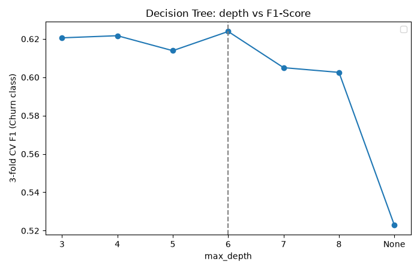
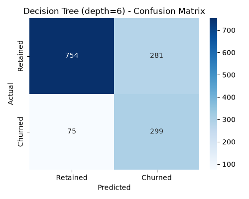
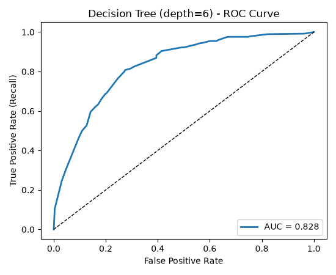
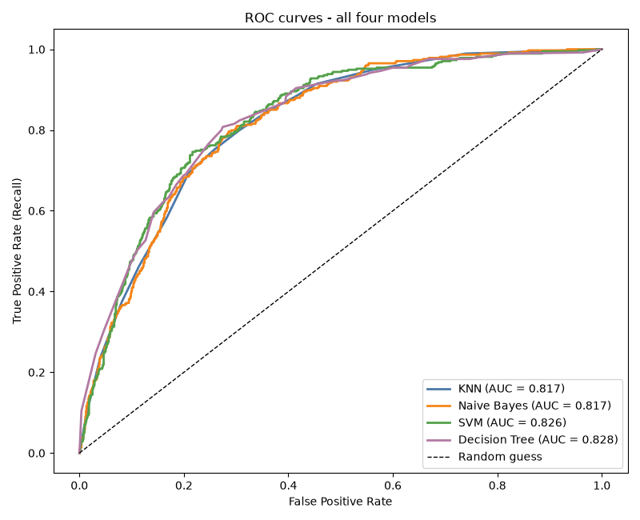

<!-- Animated header -->
<div align="center">


<!-- Typing animation -->
<a href="https://git.io/typing-svg">

</a>

<br/>


### [🎥 Watch Demo](YOUR_GOOGLE_DRIVE_LINK) &nbsp;•&nbsp; [🚀 Live App](YOUR_STREAMLIT_APP_LINK) &nbsp;•&nbsp; [📊 Dataset](https://www.kaggle.com/datasets/blastchar/telco-customer-churn)

</div>

---

## 📑 Table of Contents
- [Demo](#-demo)
- [Business Problem](#-business-problem)
- [Key Features](#-key-features)
- [Workflow](#-workflow)
- [Data Insights](#-data-insights)
- [Models & Results](#-models--results)
- [Top Churn Signals](#-top-churn-signals)
- [Streamlit App](#-streamlit-app)
- [Project Structure](#-project-structure)
- [Installation](#%EF%B8%8F-installation)
- [Future Work](#-future-work)
- [Author](#-author)

---

## 🎬 Demo

<div align="center">

[](YOUR_GOOGLE_DRIVE_LINK)

<!-- Optional: add an animated GIF of the app here -->
<!--  -->

</div>

---

## 💼 Business Problem

A telecom operator (comparable to Jio or Airtel) loses paying subscribers every month and cannot tell in advance who is about to leave. The retention team can only call **~500 customers/day**, so the model must **rank customers by churn risk** and explain what drives it.

| Error type | Meaning | Business cost |
|---|---|---|
| ❌ False Negative | Churner predicted to stay | Lose the customer's entire lifetime value |
| ⚠️ False Positive | Loyal customer flagged | One wasted call / small discount |

> 🎯 **Primary metric: Recall on the churn class**, balanced against Precision so the team is not flooded with false alarms. Accuracy alone is misleading: always predicting "No Churn" scores 73.5%.

---

## ✨ Key Features

- 🔍 **Full EDA**: univariate, bivariate, correlation analysis
- 🛠️ **Feature engineering**: `tenure_group`, `num_services`, `AutoPay`
- ⚖️ **Class imbalance handled** with SMOTE (train set only, no leakage)
- 🤖 **4 algorithms** tuned with cross-validation and compared fairly
- 🌳 **Interpretable deployed model** (Decision Tree, depth 6)
- 🎚️ **Adjustable decision threshold** in the app
- 💡 **Auto-generated retention actions** per customer
- 📦 **Single pickle pipeline** (encoding + scaling + model)

---

## 🔄 Workflow



---

## 📊 Data Insights

<div align="center">

| Target Distribution | Numeric Distributions |
|:---:|:---:|
|  |  |

| Correlation Heatmap | SMOTE Before / After |
|:---:|:---:|
|  |  |

</div>

- **26.5%** of customers churned (1,869 of 7,043), a ~2.8 : 1 imbalance
- `tenure` and `TotalCharges` are highly correlated (**0.83**), a multicollinearity signal
- `tenure` has the strongest numeric link to churn (**-0.35**)

---

## 🏆 Models & Results

Evaluated on a held-out test set of 1,409 customers (churn class metrics):

| Model | Accuracy | Precision | Recall | F1 | AUC-ROC | Train Time |
|---|:---:|:---:|:---:|:---:|:---:|:---:|
| 🥇 **Decision Tree (depth 6)** | **0.747** | **0.516** | 0.799 | **0.627** | **0.828** | 0.04 s |
| 🥈 SVM (C = 0.1) | 0.745 | 0.513 | 0.767 | 0.615 | 0.826 | 10.20 s |
| 🥉 Naive Bayes | 0.724 | 0.488 | **0.810** | 0.609 | 0.817 | 0.007 s |
| KNN (k = 15) | 0.722 | 0.485 | 0.799 | 0.604 | 0.817 | 0.005 s |

<div align="center">

| Tuning: Depth vs F1 | Confusion Matrix | ROC Curve |
|:---:|:---:|:---:|
|  |  |  |



</div>

### Why the Decision Tree?
- ✅ Best Accuracy, Precision, F1 and AUC of the four models
- ✅ Recall effectively tied for the lead (299 vs 303 churners caught)
- ✅ **Interpretable**: readable as business rules, root split is `Contract = Month-to-month`
- ✅ **Fast**: ~0.04 s training vs ~10 s for SVM, so it can be refreshed monthly
- ✅ Contacting the **top 25% riskiest customers (352)** catches **212 churners (56.7%)** at 60% precision, more than double the 26.5% base rate

---

## 🔑 Top Churn Signals

| # | Signal | Evidence | Recommended Action |
|:-:|---|---|---|
| 1 | 📄 **Month-to-month contract** | 42.7% churn vs 11.3% (1-yr) and 2.8% (2-yr) | Discount or perk to move to 1/2-year plans |
| 2 | ⏳ **First 12 months** | 47.4% churn in year one | Onboarding call in first 30-60 days, welcome offer |
| 3 | 📡 **Fibre + high bills** | 41.9% fibre churn vs 19.0% DSL | Review pricing, bundle security/tech support, push AutoPay |

> 🔥 **Highest-risk segment:** month-to-month + above-median charges + tenure ≤ 12 months is only **11.5%** of customers, yet **70%** of them churn (vs 20.9% for everyone else).

<details>
<summary><b>📈 Decision Tree feature importance (click to expand)</b></summary>

| Feature | Importance |
|---|---:|
| Contract: Month-to-month | 0.589 |
| tenure | 0.126 |
| InternetService: Fiber optic | 0.092 |
| MonthlyCharges | 0.079 |
| Contract: One year | 0.028 |
| PhoneService | 0.013 |

</details>

<details>
<summary><b>🔎 Error analysis: the "quiet churners" (click to expand)</b></summary>

The tree misses 75 of 374 churners (20%). They average **26 months** tenure (vs 14.1 for caught churners), pay **$63.2/month** (close to the $61.0 of retained customers), and only 53% are month-to-month. Contract, tenure and price alone cannot flag them, so behavioural data is needed.

</details>

---

## 🖥️ Streamlit App

[](https://telco-churn-supervised-learning.streamlit.app/)
&nbsp;

| Tab | What it does |
|---|---|
| 🔮 **Predict** | Enter a customer profile, get churn probability, risk band and retention tips |
| 📊 **Model Performance** | Test metrics, all-model comparison, feature importance chart |
| ℹ️ **About** | Pipeline and methodology summary |

**Risk bands:** 🟢 Low (below threshold) · 🟠 Elevated (threshold to 70%) · 🔴 High (70%+)

<!--  -->

---

## 📁 Project Structure

```
Customer-Churn-Prediction/
├── 📄 app.py                  # Streamlit application
├── 📄 requirements.txt        # Dependencies
├── 📂 dataset/                # Telco CSV
├── 📂 notebook/               # Analysis & modelling notebook
├── 📂 models/                 # churn_model.pkl, model_info.json
├── 📂 images/                 # EDA & evaluation plots
└── 📂 reports/                # summary_report.pdf
```

---

## ⚙️ Installation

```bash
# 1. Clone
git clone <your-repo-url>
cd Customer-Churn-Prediction

# 2. (Optional) virtual environment
python -m venv venv
venv\Scripts\activate        # Windows
# source venv/bin/activate   # macOS / Linux

# 3. Install
pip install -r requirements.txt

# 4. Run
streamlit run app.py
```

---

## 🚀 Future Work

- [ ] Add behavioural data (complaints, usage drops, network quality, contract-end dates)
- [ ] Try Random Forest, XGBoost, LightGBM with probability calibration
- [ ] Cost-based threshold tuning
- [ ] FastAPI real-time scoring service for CRM integration
- [ ] Monthly drift monitoring and retraining
- [ ] A/B test retention offers to measure real saved revenue

---

## 👤 Author

<div align="center">

### **RENSEE GAJIPARA**

[](https://www.linkedin.com/in/rensee-gajipara)
[](mailto:renseegajipara@gmail.com)

⭐ *If you found this project useful, consider giving it a star!* ⭐


</div>
